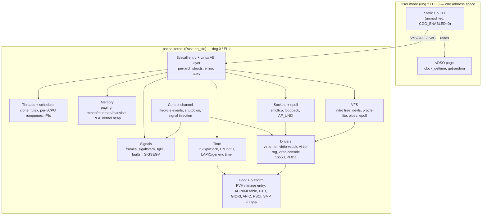
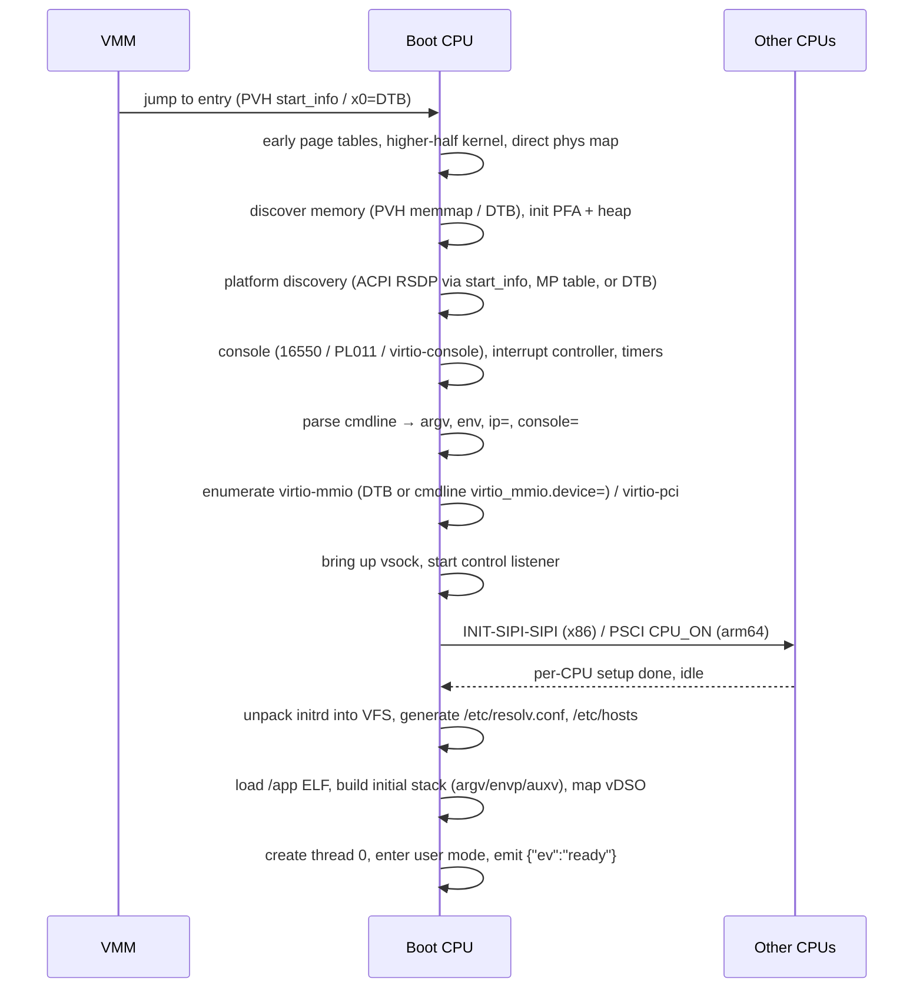
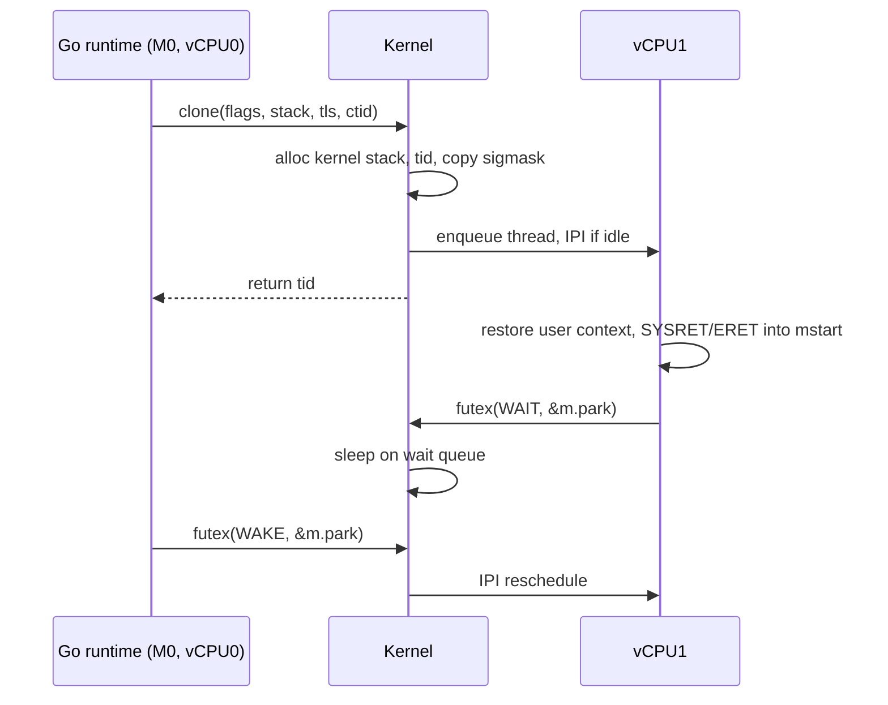
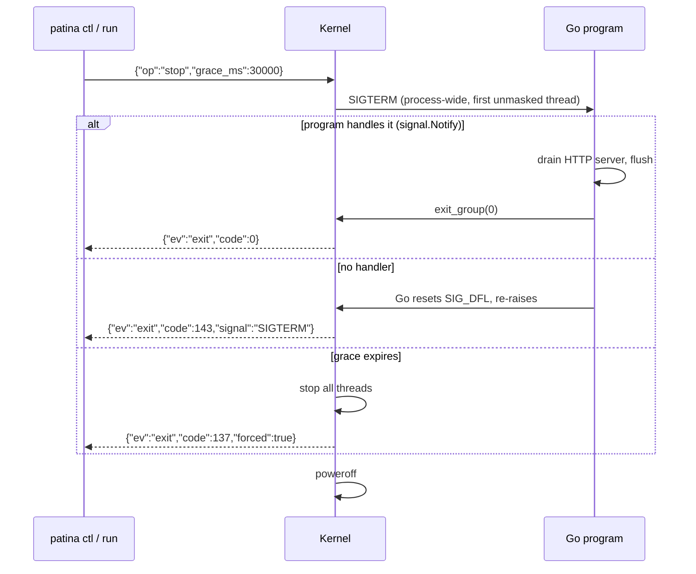

# patina — a Rust unikernel for static Go binaries

## 1. Decisions so far

| Area | Decision | Consequence |
|---|---|---|
| Go model | Unmodified `GOOS=linux` static binaries, `CGO_ENABLED=0` | Kernel implements a Linux syscall/ABI subset. No Go fork. ABI fidelity (struct layouts, signal frames, auxv) is the core correctness problem. |
| Privilege | Go runs in user mode (ring 3 / EL0) | Real `SYSCALL`/`SVC` entry, separate kernel stacks, guard pages, clean fault→signal mapping. |
| Execution | One address space, many threads, SMP | `clone()` threads map 1:1 to kernel threads scheduled across vCPUs. No `fork`/`execve`. |
| Targets | Firecracker, Cloud Hypervisor, QEMU, Apple Virtualization.framework; x86_64 + aarch64 | Direct kernel boot only (PVH ELF on x86, Linux `Image` on arm64). virtio-mmio first; virtio-pci only for QEMU's default machines. |
| Network | smoltcp in kernel, BSD socket + epoll syscalls | `net`, `net/http`, DNS work unchanged. Loopback and `AF_UNIX` needed for tests. |
| Storage | Initrd (cpio) unpacked into an in-memory writable tree at boot | No block driver. Nothing persists. "Embedded read-only" and "tmpfs" collapse into one VFS. |
| Host contract | Kernel cmdline for argv/env/net config; serial for stdout/stderr; **virtio-vsock control channel** for shutdown, lifecycle events, and exit code | Graceful `SIGTERM` has an injection path. Exit code is reported reliably; the serial sentinel remains as a fallback. |
| Boot | Direct kernel boot, no UEFI | One kernel artifact per arch. UEFI deferred until cloud targets matter. |
| Crates | Mature `no_std` crates where they fit | See §11. Each gets an audit note in-tree. |
| Tooling | Single CLI written in Go | `patina build` / `patina run` / `patina ctl`. Kernel binaries are prebuilt artifacts the CLI fetches or vendors. |
| Milestones | (A) `net/http` hello on all three VMMs, both arches, with graceful shutdown via `patina ctl stop`. (B) Go `runtime` test binary passes with a maintained skip list. | B drives most of the long tail: `AF_UNIX`, pipes, `sigaltstack` edge cases, `/proc` stubs, timers. |

## 2. Architecture



**Guiding rule:** the kernel is a Linux-ABI *emulator for one process*, not a general OS. Every feature is justified by a syscall Go's runtime or stdlib actually issues, by a test in the `runtime` suite, or by the host lifecycle contract in §10.

## 3. Boot and platform

### 3.1 Artifacts

| Arch | Format | Why it covers all targets |
|---|---|---|
| x86_64 | Static ELF with a PVH `ELFNOTE` (`XEN_ELFNOTE_PHYS32_ENTRY`) | Firecracker, Cloud Hypervisor, and `qemu -kernel` all accept PVH ELF. 32-bit protected-mode entry; kernel sets up long mode itself. |
| aarch64 | Linux `Image` header (64-byte header, `ARM\x64` magic, `text_offset`, `image_size`) | Firecracker, QEMU `virt`, and `VZLinuxBootLoader` all load this format and pass a DTB in `x0`. |

Payload (Go ELF + files) travels as an **initrd cpio**. All four VMMs support initrd natively, and it keeps the kernel artifact app-independent. A "fused" single-file image (payload appended as an ELF section) is an optional later convenience.

### 3.2 Boot sequence



### 3.3 Per-target platform matrix

| | Firecracker | Cloud Hypervisor | QEMU | Apple VZ (arm64 only) |
|---|---|---|---|---|
| x86 boot | PVH ELF | PVH ELF | `-kernel` PVH ELF | — |
| arm64 boot | `Image` + DTB | `Image` + DTB | `Image` + DTB | `Image` + DTB |
| CPU enumeration | MP table / ACPI MADT (x86), DTB (arm64) | ACPI | ACPI (x86), DTB (arm64) | DTB |
| IRQ controller | IOAPIC+LAPIC / GICv3 | same | same (GICv3 with `gic-version=3`) | GICv3 |
| Virtio transport | mmio | mmio (pci for some) | `microvm` (x86) and `virt` (arm64) expose mmio; `q35` needs pci | mmio |
| Console | 16550 (x86 port I/O, arm64 mmio) | 16550 | 16550 / PL011 | virtio-console |
| vsock | virtio-vsock → host Unix socket | virtio-vsock → host Unix socket | `vhost-vsock` (Linux host only) | `VZVirtioSocketDevice` |
| Wall clock | pvclock (x86), RTC PL031 (arm64) | pvclock / PL031 | pvclock / PL031 | none at boot; CLI passes `patina.epoch=`, control channel can re-sync |
| Poweroff | i8042 reset (x86), PSCI SYSTEM_OFF (arm64) | ACPI / PSCI | `isa-debug-exit` / PSCI | PSCI |
| Exit code channel | vsock event; serial sentinel fallback | vsock event; serial fallback | vsock event; `isa-debug-exit` + serial fallback | vsock event; serial fallback |

Use QEMU `microvm` and `virt` machines in Phase 0–4; add virtio-pci in Phase 5 so `q35` works. Console driver is selected from DTB `/chosen/stdout-path` on arm64 and from `console=` on x86.

**QEMU on macOS has no vsock** (no `vhost-vsock`, no userspace implementation). The control protocol is transport-agnostic, so that dev loop uses a second virtio-console port (`-device virtserialport,name=patina.ctl`) instead; the kernel picks whichever transport is present and the CLI hides the difference.

## 4. Memory

- **Address space.** One user address space for the lifetime of the VM. Kernel in the higher half with a direct map of all physical memory (`PHYS_OFFSET`). x86: 4-level paging, 48-bit VA, `NX`, user/supervisor split via `U/S` bit; `SMAP`/`SMEP` on when KVM exposes them. arm64: 4 KiB granule, 48-bit VA, `TTBR0` user / `TTBR1` kernel, `PAN` on.
- **ELF loading.** Static Go binaries are non-PIE and link at `0x400000`. Map `PT_LOAD` segments with their flags, zero-fill `.bss`, no relocation. Reject PIE/dynamic ELFs with a clear error (Phase 1); accept `ET_DYN` later only if asked.
- **mmap.** Go reserves large arenas and uses address *hints* (amd64 hints start at `0x00c0_0000_0000`). Honor hints when free, otherwise allocate top-down below the hint. `PROT_NONE` reservations must be cheap (no frames). `munmap`, `mprotect`, `madvise` (`DONTNEED` frees frames, `HUGEPAGE`/`NOHUGEPAGE`/`COLLAPSE` accepted and ignored) and `mremap` (used by some tests) are required.
- **Faults.** Page fault in user mode → `SIGSEGV` with `si_addr`, `si_code` (`SEGV_MAPERR`/`SEGV_ACCERR`). Alignment/`#AC`-style faults → `SIGBUS`. Fault in kernel mode → panic with register dump to serial and a `{"ev":"panic"}` control event if the channel is up.
- **Allocators.** Physical frames: buddy allocator over the direct map. Kernel heap: slab-on-top-of-buddy (`buddy_system_allocator` crate initially). User pages are allocated lazily on first touch except for ELF segments (eager).
- **Stacks.** Thread 0 gets a kernel-built user stack with Linux-exact `argv`/`envp`/`auxv` layout. Threads from `clone` use the caller-supplied stack (Go mmaps its own). Every kernel thread has a dedicated kernel stack with a guard page; interrupts use per-CPU IST/`SP_EL1` stacks.

## 5. Threads, scheduling, synchronization

- **Thread = Go M.** `clone(CLONE_VM|CLONE_FS|CLONE_FILES|CLONE_SIGHAND|CLONE_SYSVSEM|CLONE_THREAD, …)` creates a kernel thread with its own `tid`, kernel stack, signal mask, `sigaltstack`, TLS base, and `clear_child_tid` pointer. Any other flag combination → `EINVAL`.
- **TLS.** amd64: `arch_prctl(ARCH_SET_FS)` and `CLONE_SETTLS` write `FS_BASE` (via `WRFSBASE` or MSR). arm64: `TPIDR_EL0` is writable from EL0; kernel only saves/restores it.
- **Scheduler.** Per-vCPU runqueue, round-robin with a tick, wake-affinity to the waker's CPU, idle CPUs park in `HLT`/`WFI` and are woken by IPI. No priorities. Go does the real scheduling; the kernel only needs to keep every M runnable on some vCPU and keep latency on wake low.
- **Futex.** `FUTEX_WAIT`/`FUTEX_WAKE` (`_PRIVATE` variants) with timeouts; hash table of wait queues keyed by user address. That is the entirety of Go's usage. `FUTEX_REQUEUE` etc. → `ENOSYS`.
- **`sched_getaffinity`** returns a mask of all vCPUs → `GOMAXPROCS`. `sched_yield` → yield. `sched_setaffinity` accepted and ignored.
- **Exit.** `exit` ends a thread and performs `clear_child_tid` + futex wake. `exit_group` or thread 0 returning emits `{"ev":"exit","code":N}` on the control channel, prints `\n[patina] exit code N\n` to serial, and powers off.



## 6. Signals

This is the highest-fidelity ABI surface in the project. Go reads registers out of `ucontext` and `siginfo` directly.

- **Delivery model.** Per-thread pending set + per-thread mask, process-wide handler table and process-wide pending set (for `kill`-style and host-injected signals). Delivery happens on return to user mode; cross-CPU delivery (`tgkill` to a thread running elsewhere) sends an IPI so async preemption is prompt.
- **Frame layout** must match Linux byte-for-byte per arch: `rt_sigframe` with `siginfo_t`, `ucontext_t` (`uc_flags`, `uc_link`, `uc_stack`, `mcontext`, `uc_sigmask`), and on x86 an `fpstate` (XSAVE area) saved/restored around the handler. Go installs handlers with `SA_SIGINFO|SA_ONSTACK|SA_RESTORER|SA_RESTART`; the `SA_RESTORER` trampoline is Go's own, so `rt_sigreturn` just has to rebuild state from the frame.
- **Default actions.** Go installs handlers for every signal, but when the program has not called `signal.Notify` for a terminating signal, Go's handler restores `SIG_DFL` and re-raises it. The kernel must therefore implement `SIG_DFL` termination: process exits with code `128+signo` (`SIGTERM` → 143), reported through the normal exit path. This is exactly what a non-`Notify` program does when `patina ctl stop` sends `SIGTERM`.
- **Required signals and sources**
  - `SIGURG` via `tgkill` — async goroutine preemption. The common path; must be fast.
  - `SIGSEGV`/`SIGBUS` from faults — nil-pointer panics, stack guard checks.
  - `SIGFPE` from `#DE` (x86) — integer divide-by-zero panics. arm64 doesn't trap; Go checks explicitly.
  - `SIGILL`, `SIGTRAP` (`INT3`/`BRK` for `runtime.Breakpoint`).
  - `SIGPROF` from `setitimer`/`timer_create(CLOCK_THREAD_CPUTIME_ID)` — pprof. Per-thread CPU-time accounting required.
  - `SIGTERM`, `SIGINT`, `SIGHUP`, `SIGUSR1/2`, `SIGQUIT` — injected by the host over the control channel (§10). `SIGQUIT` gives Go's goroutine dump on stderr for free.
  - `SIGPIPE`, `SIGCHLD` (never raised; handler install must still succeed).
- **`sigaltstack`** per thread; honored when `SA_ONSTACK`. `rt_sigprocmask`, `rt_sigaction` for all 64 signals (realtime ones stored but never raised), `kill(getpid(), sig)` and host-injected signals → deliver to any thread not masking it.

## 7. Syscall surface

Numbers and struct layouts differ between amd64 and arm64 (e.g. `struct stat`, `epoll_event` packing on amd64, `openat`-only on arm64). The ABI layer is per-arch; the VFS/net/sched cores are arch-neutral.

**Tier 1 — Go runtime boots and schedules** (Phases 1–2)
`read write openat close exit exit_group getpid gettid tgkill kill rt_sigaction rt_sigprocmask sigaltstack rt_sigreturn mmap munmap madvise mprotect mremap clone futex sched_yield sched_getaffinity arch_prctl(x86) clock_gettime gettimeofday nanosleep getrandom setitimer timer_create timer_settime timer_delete prlimit64 getrlimit uname pipe2 fcntl ioctl(TCGETS→ENOTTY) epoll_create1 epoll_ctl epoll_pwait eventfd2`

**Tier 2 — `os`, `io`, `time`, `net`** (Phases 3–4)
`pread64 pwrite64 readv writev lseek newfstatat/fstat statx getdents64 mkdirat unlinkat renameat2 readlinkat symlinkat linkat ftruncate fchmod fchown utimensat fsync faccessat2 dup dup3 getcwd chdir getuid geteuid getgid getegid socket socketpair bind listen accept4 connect getsockname getpeername setsockopt getsockopt sendto recvfrom sendmsg recvmsg shutdown`

**Tier 3 — test-suite long tail** (Phase 5)
`membarrier` (ENOSYS is fine), `sched_setaffinity`, `getrusage`, `times`, `mincore`, `prctl`, `umask`, `getpgrp`, `setpgid`, `wait4`→`ECHILD`, `execve`/`fork`/`vfork`→`ENOSYS`.

**Optional — `AF_VSOCK` for the Go program** (Phase 5+). The vsock driver is already in the kernel for the control channel; exposing `AF_VSOCK` stream sockets through the normal socket syscalls lets Go code (e.g. `mdlayher/vsock`) talk to the host without a network. Cheap to add once the driver exists; not required for either milestone.

Unknown syscalls return `ENOSYS` and log once per number to serial. The CLI's `patina run --strace` flag turns on per-call tracing.

**auxv** must include `AT_PAGESZ`, `AT_PHDR/PHENT/PHNUM`, `AT_ENTRY`, `AT_RANDOM` (16 bytes), `AT_HWCAP` (arm64: derived from `ID_AA64ISAR0_EL1` so Go picks LSE atomics and CRC32), `AT_HWCAP2`, `AT_SYSINFO_EHDR` (once the vDSO exists), `AT_SECURE=0`, `AT_UID`… .

**vDSO (Phase 5, performance).** Go calls `nanotime` constantly and falls back to the real syscall when `AT_SYSINFO_EHDR` is absent — correct but slow. Ship a tiny ELF vDSO exporting `__vdso_clock_gettime`, `__vdso_gettimeofday`, and `__vdso_getrandom` (Go ≥1.24) with version `LINUX_2.6`, reading a shared `vvar` page with TSC/`CNTVCT` scale and offset.

**Files Go reads at startup** (must exist or fail gracefully): `/sys/kernel/mm/transparent_hugepage/hpage_pmd_size`, `/proc/self/exe` (→ `/app`), `/proc/self/maps` (minimal, for a few tests), `/etc/resolv.conf`, `/etc/hosts`, `/etc/nsswitch.conf`, `/dev/null`, `/dev/urandom`.

## 8. Filesystem

Single in-memory tree, mounted as root, populated from the initrd cpio at boot and writable thereafter (tmpfs semantics). Special nodes are virtual:

- `/dev`: `null zero full urandom random console stdin stdout stderr`
- `/proc`: `self/exe` (symlink to `/app`), `self/maps`, `self/status` (minimal), `sys/kernel/*`, `cpuinfo`, `meminfo`
- `/sys/kernel/mm/transparent_hugepage/hpage_pmd_size` → `2097152`
- `/tmp` exists and is writable

File descriptors are a per-process table (shared by all threads, as `CLONE_FILES` implies) holding `Arc<dyn File>`; pipes, eventfds, sockets, epoll instances, and regular files all implement the same trait with `read/write/poll/ioctl`. `O_NONBLOCK`, `O_CLOEXEC` (no-op), `FD_CLOEXEC` all honored.

## 9. Networking

- **Driver.** virtio-net via `virtio-drivers` (mmio and pci transports). One RX/TX queue pair initially; multi-queue later. Checksum/TSO offload off in Phase 4.
- **Stack.** smoltcp `Interface` owned by a kernel task driven by the virtio IRQ and the timer tick. Socket syscalls operate on kernel `Socket` objects that wrap smoltcp handles plus wait queues.
- **Required behavior.** Blocking and non-blocking sockets, `SO_REUSEADDR`, `TCP_NODELAY`, `SO_KEEPALIVE` (accepted), `IPV6_V6ONLY`, `accept4` with `SOCK_NONBLOCK|SOCK_CLOEXEC`, `sendmsg`/`recvmsg` with iovecs, `MSG_PEEK`. `net/http` needs nothing exotic.
- **Loopback** (`127.0.0.1`, `::1`) is a smoltcp loopback device — the `net` tests and `httptest` depend on it.
- **`AF_UNIX`** stream and datagram implemented in-kernel (not via smoltcp); needed by `net` tests and `socketpair`.
- **Config.** `ip=` on the cmdline in the Linux `ip=client:server:gw:mask:host:dev:autoconf[:dns0[:dns1]]` form; `dhcp` supported via smoltcp's DHCPv4 client. `/etc/resolv.conf` and `/etc/hosts` are generated at boot.
- **DNS** is Go's resolver (pure Go, reads `resolv.conf`); the kernel only forwards UDP.

## 10. Control channel

The host's only way to reach *into* a running VM. Separate from the Go program's network so it works with no NIC configured and cannot be reached from the program's peers.

### 10.1 Transport

- **Primary: virtio-vsock.** Guest CID is assigned by the VMM; the kernel listens on vsock port **`4242`**. The host connects (Firecracker/CH: `CONNECT 4242\n` over the Unix socket; Apple VZ: `VZVirtioSocketDevice.connect(toPort:)`; QEMU on Linux: `AF_VSOCK` connect to the guest CID). One connection at a time; a new connection replaces the old one.
- **Fallback: a named virtio-console port** (`patina.ctl`) for QEMU on macOS. Same framing, same messages.
- The channel is kernel-owned. The Go program never sees it unless `AF_VSOCK` is enabled later, and even then port 4242 stays reserved.

### 10.2 Framing and messages

Newline-delimited JSON, one message per line, UTF-8. Small enough to hand-parse in `no_std` (a minimal parser in-tree; no serde). Unknown fields are ignored; unknown `op`s get an error reply.

Host → guest:

| Message | Behavior |
|---|---|
| `{"op":"ping","id":1}` | Reply `{"ev":"pong","id":1,"uptime_ms":…}`. |
| `{"op":"signal","sig":"SIGTERM"}` | Deliver the named signal process-wide (same path as `kill(getpid(), sig)`). Any of the host-injectable signals in §6. |
| `{"op":"stop","grace_ms":30000}` | Send `SIGTERM`, start a grace timer. If the program exits in time, normal exit. If not, kill all threads and power off with `{"ev":"exit","code":137,"forced":true}`. `grace_ms` of 0 is an immediate forced stop. |
| `{"op":"time","epoch_ns":…}` | Step the wall clock. Used by the CLI on Apple VZ at boot and on demand. |
| `{"op":"dump"}` | Equivalent to `signal SIGQUIT`: Go prints all goroutine stacks to stderr. |

Guest → host (unsolicited events):

| Event | When |
|---|---|
| `{"ev":"ready","go":"go1.25.1","cpus":2,"mem_mb":512}` | Thread 0 is about to enter user mode. `go` is read from the ELF's `.go.buildinfo`. |
| `{"ev":"exit","code":N,"signal":"SIGTERM"?,"forced":bool}` | Last event before poweroff. `signal` is set when the exit was a `SIG_DFL` termination. |
| `{"ev":"panic","msg":"…"}` | Kernel panic. Followed by the register dump on serial and poweroff with code 255. |
| `{"ev":"log","level":"warn","msg":"ENOSYS 334"}` | Kernel-side diagnostics (unknown syscalls, dropped packets). Serial carries the same lines; vsock is for machine consumption. |

### 10.3 Shutdown sequence



`patina run` wires its own `Ctrl-C` to `stop` with a default 10 s grace, so the dev loop behaves like running the binary locally.

## 11. Crates (initial list, each with an in-tree audit note)

| Purpose | Crate |
|---|---|
| x86 CPU/paging/MSRs | `x86_64`, `raw-cpuid`, `x2apic` |
| arm64 CPU/system regs | `aarch64-cpu`, `tock-registers` |
| ACPI tables | `acpi` (rust-osdev) |
| Device tree | `fdt` |
| GIC, PSCI, PL011 | `arm-gic`, `smccc`, `arm_pl011` |
| 16550 | `uart_16550` |
| Virtio (net, vsock, console, rng) | `virtio-drivers` |
| TCP/IP | `smoltcp` |
| ELF | `elf` (`no_std` parser) |
| Allocators | `buddy_system_allocator` (swap for in-tree slab later) |
| Locks | `spin` / `lock_api`; own per-CPU and IRQ-safe wrappers |
| ABI structs | `zerocopy`, `bitflags` |
| Logging | `log` |

Arch entry code (PVH 32→64 transition, `Image` header, exception vectors, context switch, syscall entry) is written in-tree with `global_asm!`. The control-channel JSON parser is in-tree (a few hundred lines) rather than pulling `serde-json-core`.

## 12. CLI (Go)

```
patina build ./cmd/server --target firecracker-x86_64 --files ./static:/static -o server.patina
patina run   server.patina --mem 512 --cpus 2 --net tap0 -- --port 8080
patina run   server.patina --vmm qemu --strace
patina ctl   <vm> stop --grace 30s
patina ctl   <vm> signal SIGHUP
patina ctl   <vm> dump
patina image inspect server.patina
```

- `build` runs `go build` with `GOOS=linux CGO_ENABLED=0 -ldflags=-extldflags=-static`, refuses cgo/PIE output, writes a cpio with `/app` plus `--files` mappings, and bundles it with the matching prebuilt kernel into a tarball-with-manifest (`.patina`).
- `run` drives the VMM: Firecracker via its API socket, Cloud Hypervisor via its API, QEMU via argv, Apple VZ via a small cgo/ObjC shim (acceptable in the CLI; never in the kernel). It always configures a vsock device (or the console-port fallback), connects to the control channel, translates `-- args` into cmdline, streams serial to the terminal, forwards `Ctrl-C` as `stop`, and exits with the code from the `exit` event (serial sentinel if the channel never came up).
- `ctl` attaches to a VM started by `run` (or to any VMM's vsock endpoint given explicitly with `--vsock path|cid`) and sends one op. This is what orchestration scripts call for graceful rollouts.
- **Cmdline encoding.** `console=… ip=… patina.epoch=<unix> patina.env=K=V,K=V -- arg1 arg2`. Everything after `--` is argv (Linux convention); values containing spaces are URL-percent-encoded by the CLI and decoded by the kernel.
- Kernel binaries are release artifacts (`kernel-x86_64-pvh.elf`, `kernel-aarch64.Image`) fetched by version or overridden with `--kernel`.

## 13. Testing

| Layer | How |
|---|---|
| Rust unit tests | VFS, syscall decoders, ABI struct layouts (size/offset assertions against Linux headers), control-channel parser, smoltcp integration — all host-side `cargo test`. |
| ABI layout check | A generated test compares `#[repr(C)]` structs against offsets extracted from Linux UAPI headers for both arches. Drift here is the most likely silent bug. |
| Boot smoke | CI boots the kernel under QEMU (TCG when no KVM) on both arches and expects the `ready` event. |
| Milestone A | `net/http` hello + `curl` from the host, then `patina ctl stop` and assert a clean `exit` event, on Firecracker (Linux x86 KVM runner), QEMU (both arches), Apple VZ (macOS arm64 runner). Both the `signal.Notify` and the no-handler (exit 143) variants. |
| Milestone B | Host builds `go test -c -o runtime.test runtime` (and `os`, `net`, `os/signal`, `time`, `sync`, `syscall`), packs it as `/app`, runs with `-test.short -test.skip=<regex from skiplist.txt>`. Skip list covers tests that need `os/exec`, the `go` tool, `/proc` details, `GODEBUG` re-exec, `ptrace`, or cgo. Each skipped test carries a reason; the list only shrinks. `os/signal` tests that `kill` themselves are good coverage for the injection path. |
| Go versions | Latest two Go releases in the matrix. New runtime syscalls land first as `ENOSYS` logs in this job. |

## 14. Phases

0. **Bring-up.** Cargo workspace, both arch entries, paging, serial, panic handler, CI boot smoke on QEMU.
1. **Hello.** ELF loader, user mode, syscall entry, Tier-1 syscalls for a single-threaded `fmt.Println`. First Go binary runs.
2. **Runtime.** `clone`, futex, signals, timers, SMP bring-up, `sched_getaffinity`. Goroutines, GC, async preemption, pprof all work. Firecracker x86 + arm64.
3. **OS.** VFS, initrd, devfs/procfs, pipes, eventfd, epoll, `os` package tests. **Control channel** lands here: it needs virtio and signals but not the network, and having `stop` early makes every later CI job cleaner.
4. **Net.** virtio-net, smoltcp, sockets, loopback, `AF_UNIX`, `ip=` config. **Milestone A** on all three VMMs, both arches. CLI `build`/`run`/`ctl` ship here.
5. **Hardening.** Runtime test suite harness and skip-list burn-down (**Milestone B**), vDSO, virtio-pci for QEMU `q35`, console-port control fallback for QEMU/macOS, `AF_VSOCK` for the program, `strace`, multi-queue net, per-syscall benchmarks.

## 15. Risks and open questions

- **Signal-frame and `struct` fidelity.** A single wrong offset in `mcontext` or `siginfo` produces heisenbugs under preemption. Mitigation: the generated layout test in §13 and an early stress test that spins `GOMAXPROCS` goroutines under `SIGURG` storms.
- **Go version drift.** Each Go release can add a syscall (recent examples: `getrandom` via vDSO, `MADV_COLLAPSE`, `eventfd2`, `prlimit64`). Mitigation: `ENOSYS` logging plus the two-version CI matrix.
- **No `fork`/`exec` means parts of the Go stdlib tests are permanently skipped.** Accepting this is what makes the kernel small; the skip list is the honest record.
- **Control channel is unauthenticated.** It trusts whoever can reach the VMM's vsock endpoint, which on every target is a host-local resource with filesystem permissions. Acceptable for VMs owned by the orchestrator; revisit if the channel is ever bridged off-host.
- **QEMU on macOS lacks vsock.** The console-port fallback keeps the dev loop working but is Phase 5; until then QEMU/macOS gets no graceful stop. Apple VZ is the primary macOS target anyway.
- **Virtio transport on QEMU.** `microvm`/`virt` keep Phase 4 mmio-only; users who launch with `q35` get an early, clear error until Phase 5.
- **Memory pressure.** No swap, no overcommit accounting; `mmap` beyond physical RAM fails with `ENOMEM` and Go reports it. Fine for VMs sized by the CLI, worth a `--mem` sanity check against the binary's hinted arena size.
- **Open:** should the control channel also carry structured application logs (Go's `log/slog` → a `/dev/patina-log` device), or is serial enough? Not needed for either milestone; decide once there's a real deployment story.
